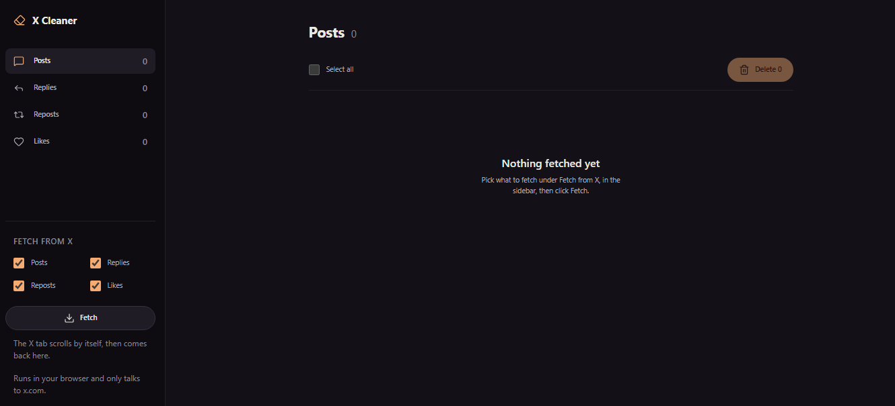
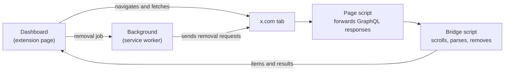

<div align="center">
  
  <h1>X Cleaner</h1>
  <p><strong>Review and bulk-remove your own posts, replies, reposts and likes on X, unfollow accounts that don't follow you back and remove followers.</strong></p>
  <p>
    
    
    
    
    
  </p>
</div>

<p align="center">
  
</p>

X Cleaner is a Chrome extension that lists everything you posted and liked on X (formerly Twitter) in a calm reading view, lets you pick exactly what to remove, and removes it for you: it deletes posts and replies, undoes reposts and removes likes. It also lists who doesn't follow you back and who follows you, so you can unfollow accounts or remove followers.

It works with your normal x.com session. There is no account to create, no server and no API key.

> [!WARNING]
> **Unofficial and permanent.** X Cleaner is not affiliated with X Corp. It uses the same internal web API the x.com site uses, which can change without notice, and automating actions on X may go against its Terms of Service. Use it on your own account and at your own risk. **Removed items cannot be restored.**

## Features

- **Fetch** your posts, replies, reposts, likes, following and followers straight from x.com. The X tab scrolls through your profile by itself, then through an X search for your posts, replies and reposts, since X leaves some of them off your own profile.
- **Read before you remove.** Every item shows its date, context and full text, with a link back to X.
- **Select with confidence.** Select item by item or a whole tab at once; the sidebar shows how many items are selected in each type.
- **Clear confirmation.** A dialog lists what will happen for each type ("Delete 12 posts", "Remove 30 likes"), how long it will take and that it is permanent.
- **Visible progress.** See how many items are left and an estimate of the time remaining. Stop at any time; anything not removed stays in the list.
- **Runs in the background.** Close the dashboard and removals keep going; turn this off in the confirmation dialog if you prefer. A badge on every x.com tab shows the progress with a Stop button, and a system notification tells you when it's done. Keep the x.com tab open.
- **Failures are kept.** Items that fail stay in the list with the reason, and you can select them all to try again.
- **Not following back.** See who you follow that doesn't follow you, with verified badges and follower counts so you can skip news sites and public figures, sort the list and unfollow in bulk.
- **Followers.** See who follows you, whether you follow them back, and their follower and following counts. Filter mutual follows or the ones you don't follow back, then remove the followers you choose. They are not notified, but they can follow you again.
- **Gentle with your account.** Unfollows and follower removals go one at a time, 5 to 8 seconds apart. Unfollows stop at 250 per day and the rest stay selected for later; follower removals have no daily cap.
- **Rate-limit aware.** When X limits requests, the extension waits and resumes on its own.
- **English and Portuguese**, following your browser language.

## How to run

### Requirements

- [Node.js](https://nodejs.org) **22.12 or newer**
- **Google Chrome** (other Chromium-based browsers may work, but are untested)
- An X account you are logged in to on x.com

### Install

There is no Chrome Web Store release yet, so you build it from source:

```bash
git clone https://github.com/evertoont/x-cleaner.git
cd x-cleaner
npm install
npm run build
```

Then load it in Chrome:

1. Open `chrome://extensions`.
2. Turn on **Developer mode** (top-right corner).
3. Click **Load unpacked** and select the `.output/chrome-mv3` folder inside the project.
4. Pin X Cleaner from the extensions menu and click its icon to open the dashboard.

### Update

```bash
git pull
npm install
npm run build
```

Then click the reload button on the X Cleaner card in `chrome://extensions`.

## How to use

1. **Log in to x.com** in the same Chrome profile.
2. **Fetch.** Under **Fetch from X**, check what you want (posts, replies, reposts, likes, following, followers) and click **Fetch**. The x.com tab comes to the front, scrolls through the pages it needs and comes back to the dashboard. Fetching never removes anything.
3. **Review and select** what you want to remove in each tab. Accounts are under **People**: **Not following back** and **Followers**.
4. **Remove.** Click the remove button, check the summary in the dialog and confirm. Keep the x.com tab open until it finishes (about 3 seconds per item and 7 per account). You can close the dashboard: the removal keeps going in the background, with a badge on x.com and a notification at the end. Uncheck **Keep going if I close this tab** in the dialog if you'd rather stop when the dashboard closes.

> [!TIP]
> A new fetch only replaces the types you checked. If you stop a fetch halfway, what was found so far is added to the list and nothing else is touched.

## Privacy

- Everything runs in your browser. There is no backend, analytics or tracking.
- Fetched items are stored only in the extension's local storage (`chrome.storage.local`).
- The only network requests go to x.com, reusing the session you are already logged in with, the same way the site does. Your password is never touched, and your session cookies are never stored or sent anywhere else.

## Known limitations

- X may not load your oldest likes. This is a limitation of X itself.
- Some posts appear neither on your profile nor in X search, so X Cleaner can't find them. The post count on your profile may stay above zero because of them.
- X does not publish limits for unfollows or follower removals. The 250-per-day unfollow cap is a conservative choice to avoid looking automated, not an official number.
- X changes its internal web API from time to time. If a fetch comes back empty, open **Technical details** below the toolbar and include that text when you open an issue.

## How it works



- **Fetching:** a script running in the x.com page forwards the GraphQL responses the site already loads while you scroll. The bridge script scrolls until the timeline ends and turns those responses into items. For posts, replies and reposts it then does the same on an X search (`from:<you>`, with `-filter:replies`, `filter:replies` or `filter:nativeretweets`), because X leaves some of your own posts off your profile. Items found in both places are listed once.
- **Removing:** the bridge calls X's internal mutations with your logged-in session, one item at a time, 2 to 3 seconds apart: `DeleteTweet` for posts, replies and reposts (`DeleteRetweet` when only the original post is known) and `UnfavoriteTweet` for likes.
- **People:** fetching **Following** and **Followers** scrolls `x.com/<you>/following` and `x.com/<you>/followers`; each account comes with both sides of the relationship, so one pass per list is enough. Unfollowing calls `friendships/destroy` and removing a follower calls the `RemoveFollower` mutation, with the same session.
- **Dashboard:** an extension page that drives the x.com tab while fetching and keeps the list.
- **Background:** the removal queue runs in the service worker and saves its progress after every item, so it survives the dashboard closing. An alarm wakes the worker when Chrome suspends it (for example, while waiting out a rate limit) and the queue resumes where it stopped.

If X changes something internal, the places to adjust are the `queryId`s in `lib/removal-operations.ts` and the operation names in `lib/page-capture.ts`.

## Project structure

| Path | What lives there |
|---|---|
| `entrypoints/dashboard/` | The dashboard page (React) |
| `entrypoints/background.ts` | Service worker that runs the removal queue and shows the notification |
| `entrypoints/x-page.content.ts` | Page script that forwards x.com GraphQL responses |
| `entrypoints/x-bridge.content.ts` | Bridge between the extension and the x.com tab; also shows the removal badge |
| `components/` | Dashboard components (navigation, list, action bar, confirmation dialog) |
| `lib/` | Parsing, fetching, removal and progress logic |
| `lib/messages/` | English and Portuguese texts |
| `tests/` | Unit tests and response fixtures |

## Development

| Command | What it does |
|---|---|
| `npm run dev` | Starts WXT in development mode with live reload |
| `npm run build` | Builds the extension into `.output/chrome-mv3` |
| `npm run zip` | Builds and packs the extension into a zip in `.output/` |
| `npm run typecheck` | Type-checks the project |
| `npm run lint` | Lints with ESLint |
| `npm test` | Runs the unit tests |

Issues and pull requests are welcome.

## License

[MIT](LICENSE.md) © 2026 Everton Reis
